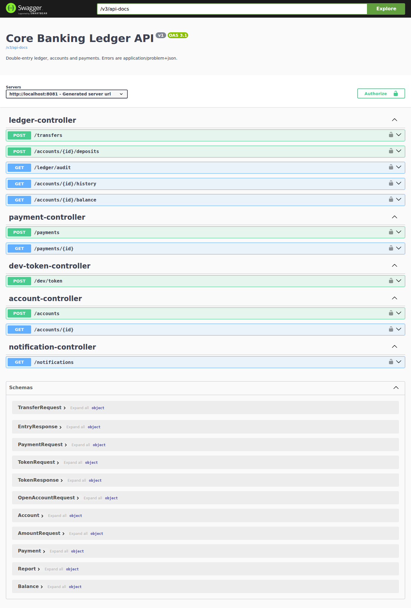
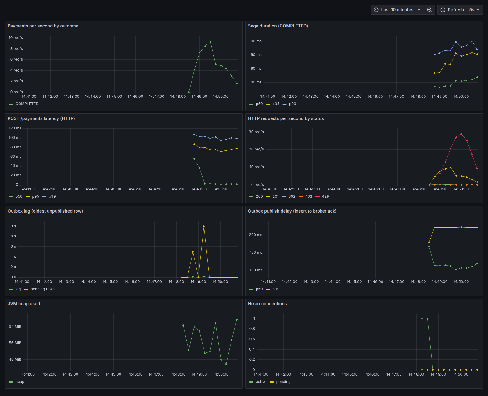

# core-banking-ledger

**Start here: [docs/GUIDE.md](docs/GUIDE.md)** (study guide: how every part works, traced through the code).

A production-style banking backend in Java 21 and Spring Boot 3.5. It has accounts, a double-entry
ledger, payments run as an orchestrated saga, and notifications fed by Kafka (Redpanda) events
through a transactional outbox. Postgres is the system of record. The build includes JWT security,
rate limiting, OpenAPI docs, Prometheus metrics, OpenTelemetry tracing, a Grafana dashboard,
a k6 load test, a Helm chart and a GitHub Actions pipeline.

## Why it is hard

Moving money is easy until two requests touch the same account at once, a client retries,
or the process dies halfway through a transfer. This project is about staying correct when that happens:

- **No money is created or lost.** Every journal entry sums to zero per currency, and a system
  funding account makes the sum over all accounts always 0. `GET /ledger/audit` recomputes every
  balance from the postings and reports any drift.
- **Concurrency.** There are two locking strategies (`SELECT ... FOR UPDATE` and version-checked
  optimistic updates) behind one code path. A stress test runs 16 threads against 10 hot accounts.
- **Retries.** Idempotency keys are claimed atomically with `INSERT ... ON CONFLICT`. A retry gets
  back exactly the same response, byte for byte.
- **Partial failure.** The payment saga (reserve, post, notify) compensates in reverse order. A
  recovery job undoes any saga that crashed partway through.
- **Events.** Events go out through a transactional outbox with at-least-once delivery, and the
  consumer is idempotent, so each event produces exactly one notification.

## Architecture

It is a modular monolith built from Maven modules: `common`, `accounts`, `ledger`, `payments`,
`notifications`, and `app`, which boots the service and owns the Flyway migrations V1 to V5. Modules
depend only downward (payments → ledger → accounts → common). Notifications sees only Kafka events,
so it can be split into its own service later. See [docs/DESIGN.md](docs/DESIGN.md) and
[docs/FEATURES.md](docs/FEATURES.md).

## Key results

All numbers come from one `scripts/reproduce.sh` run on 2026-11-15. The machine was an Intel
i5-14500HX (20 threads) with 7 GB RAM, running Linux 6.6 under WSL2.

**k6 load test, `POST /payments`** (`results/k6_payments.md`). 20 constant VUs ran for 60 s. Each VU is
its own customer with its own JWT, and 5% of requests are idempotent replays. The app ran as a single
instance with PESSIMISTIC locking, tracing on at 100% sampling and the rate limit lifted.

| metric | value |
|---|---|
| requests | 23,477 |
| throughput | 380.4 req/s |
| error rate | 0.00% |
| latency p50 / p95 / p99 | 50.2 / 70.1 / 85.9 ms |
| max latency | 319.4 ms |
| ledger audit after the run | clean: no unbalanced entries, balance or hold mismatches (`results/k6_ledger_audit.json`) |

**Prometheus during the run** (`results/k6_prometheus_check.json`):
`bank_payments_total{outcome="COMPLETED"}` was 12,529, the same as the saga timer count. The saga
p99 was 61 ms, the outbox lag was 0.14 s with 54 rows pending, and the outbox publish-delay p99 was
227 ms. The relay polls every 200 ms, so that delay is the polling interval plus batching.

**Concurrency stress test** (`results/concurrency_it.csv`, `ConcurrencyIT`). 16 threads ran 4,000
random operations over 10 accounts. Conservation held, no account went negative and the audit was clean.

| scenario | committed | rejected (insufficient funds) | optimistic retries | ops/s |
|---|---|---|---|---|
| saga payments, PESSIMISTIC | 3,477 | 523 | 0 | 426 |
| transfers, PESSIMISTIC | 3,474 | 526 | 0 | 673 |
| transfers, OPTIMISTIC | 3,492 | 508 | 6,562 | 565 |

Laptop numbers vary between runs. DECISIONS.md records two earlier k6 runs, made while other work
was running, at about 300 req/s.

## Quick start

You need Docker, Java 21, Maven, curl and jq (the demo uses jq to read tokens).

```bash
docker compose up -d                       # Postgres 16 + Redpanda
mvn -B verify                              # unit, contract and Testcontainers ITs
java -jar app/target/app-0.1.0-SNAPSHOT.jar --spring.profiles.active=dev   # jar built by mvn verify
# Swagger UI: http://localhost:8080/swagger-ui.html
```

To regenerate everything in `results/` (mvn verify followed by the k6 run):

```bash
scripts/reproduce.sh
```

## Demo

These commands show the main flows. Record them with a terminal recorder such as asciinema for a GIF.
`/dev/token` exists only under the `dev` profile.

```bash
ADMIN=$(curl -s localhost:8080/dev/token -H 'Content-Type: application/json' \
  -d '{"subject":"ops","roles":["ADMIN"]}' | jq -r .access_token)
ALICE=$(curl -s localhost:8080/dev/token -H 'Content-Type: application/json' \
  -d '{"subject":"alice","roles":["CUSTOMER"]}' | jq -r .access_token)

# open two accounts and fund one (admin only); ids are captured so this works on a non-empty DB
A=$(curl -s localhost:8080/accounts -H "Authorization: Bearer $ADMIN" -H 'Content-Type: application/json' \
  -d '{"owner":"alice","currency":"SGD","overdraftLimit":0}' | jq -r .id)
B=$(curl -s localhost:8080/accounts -H "Authorization: Bearer $ADMIN" -H 'Content-Type: application/json' \
  -d '{"owner":"bob","currency":"SGD","overdraftLimit":0}' | jq -r .id)
curl -s localhost:8080/accounts/$A/deposits -H "Authorization: Bearer $ADMIN" \
  -H 'Content-Type: application/json' -d '{"amount":10000}'; echo     # {"entryId":...}

# pay as alice; send the same request twice to see the idempotent replay (identical 201 bodies)
KEY=demo-$RANDOM
for i in 1 2; do
curl -s -w ' HTTP %{http_code}' localhost:8080/payments -H "Authorization: Bearer $ALICE" \
  -H "Idempotency-Key: $KEY" -H 'Content-Type: application/json' \
  -d "{\"fromAccount\":$A,\"toAccount\":$B,\"amount\":2500,\"currency\":\"SGD\",\"reference\":\"lunch\"}"; echo
done

curl -s localhost:8080/accounts/$A/balance -H "Authorization: Bearer $ALICE"; echo   # balance 7500
curl -s localhost:8080/ledger/audit -H "Authorization: Bearer $ADMIN"   # {"ok":true,...}
```

## See it working

Each step was run on 2026-11-16. If port 8080 is taken on your machine, start the app with
`SERVER_PORT=8081` and use that port below.

1. **Start everything.** `docker compose --profile observability up -d`, then `mvn -B verify` (or
   skip it if the jar is already built) and
   `TRACING_ENABLED=true java -jar app/target/app-0.1.0-SNAPSHOT.jar --spring.profiles.active=dev`.
   You should see `Started CoreBankingApplication` in the log.
2. **Open the API docs.** Go to http://localhost:8080/swagger-ui.html. You should see the page
   below, with the ledger, payment, dev-token, account and notification endpoints.
   
3. **Run the Demo above.** You should see two identical `HTTP 201` payment bodies (the second is the
   idempotent replay), a balance of 7500, and `"ok":true` from the audit. A second later
   `GET /notifications?accountId=<alice's id>` (admin token) shows
   "Payment of 25.00 SGD to account ... completed", delivered through the outbox and Kafka.
4. **Open the dashboard.** Put some load on the app (`scripts/run-k6.sh` for the full test, or loop
   the demo payment for a minute), then go to http://localhost:3000/d/core-banking-ledger.
   You should see the eight panels fill in. The screenshot below came from 10 customers paying in a
   loop for 90 s with the default rate limit (30/min each), so most requests were 429s (red).
   
5. **Open a trace.** Go to http://localhost:16686, pick the service `core-banking-ledger` and click
   *Find Traces*. You should see one trace per request; open one to see its spans.

Stop with `docker compose --profile observability down`.

## Deployment

- **Image**: a multi-stage `Dockerfile` with a layered Boot jar on a JRE Alpine image. It runs as
  non-root UID 10001.
- **Helm**: `deploy/helm/core-banking-ledger` contains a Deployment, Service, ConfigMap and Secret.
  It deploys only the app, so point it at a managed Postgres and Kafka. Set `image.repository`,
  `config.jwtIssuerUri` (the app refuses to start outside `dev` without one), and either
  `secret.existingSecret` or the DB credentials:
  `helm install bank deploy/helm/core-banking-ledger --set image.repository=<registry>/core-banking-ledger --set config.jwtIssuerUri=<issuer> --set secret.existingSecret=<name>`.
  For a free tier, any small Kubernetes cluster works with a hosted Postgres and a hosted
  Kafka-compatible broker. This was validated with `helm lint` and kubeconform only. It has not
  been deployed to a cluster.
- **CI** (`.github/workflows/ci.yml`): runs `mvn verify` with Testcontainers, then `docker build` and
  a Trivy scan, then `helm lint` and kubeconform. There is no deploy job because no cluster
  credentials exist.

## Known gaps

- It is a **modular monolith**, not separate microservices. The boundaries are kept (no
  cross-module foreign keys, events only into notifications), but everything ships as one deployable.
- **Recovery always compensates.** A crashed saga is undone, never rolled forward.
- **No statement Q&A.** Only the transaction categoriser half of the GenAI feature exists.
- **The categoriser is tested with the mock provider only.** The Anthropic provider is unit-tested
  against a mocked SDK client, and no end-to-end test runs the endpoint with the flag on.
- **The image scan is non-blocking.** Trivy reports CRITICAL/HIGH findings but does not fail the build.
- Other gaps: idempotency keys have no TTL, traces do not follow an event through the outbox, the
  rate limit applies per instance, and FX is not supported (cross-currency payments are rejected).

## Target roles

These are backend and platform engineering roles at banks and consultancies (DBS, Accenture, MAS).
The project shows Java and Spring Boot, transactional correctness under concurrency, sagas and the
outbox pattern, Kafka, Postgres, API security, observability, Kubernetes and CI/CD.

More: [docs/FEATURES.md](docs/FEATURES.md) · [docs/DESIGN.md](docs/DESIGN.md) ·
[docs/INTERVIEW_NOTES.md](docs/INTERVIEW_NOTES.md) · [RESUME_BULLETS.md](RESUME_BULLETS.md) ·
[DECISIONS.md](DECISIONS.md)
