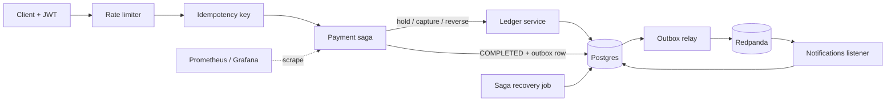

# Features

Paths are shortened: `<module>/…/X.java` means `<module>/src/main/java/com/corebank/<module>/X.java`.

## Tech stack

| Language / framework / tool | Used for |
|---|---|
| Java 21, Spring Boot 3.5.6, Maven multi-module | The service, split into `common`, `accounts`, `ledger`, `payments`, `notifications` and `app` |
| Spring JDBC (`JdbcClient`) | All SQL, written by hand so locking, `ON CONFLICT` and `SKIP LOCKED` are explicit (no JPA) |
| PostgreSQL 16 + Flyway | System of record. Migrations `V1`–`V5` are in `app/src/main/resources/db/migration` |
| Redpanda (Kafka API) | Payment events from the outbox to notifications |
| Spring Security OAuth2 resource server | RS256 JWT authentication, with roles from the `roles` claim |
| Bucket4j + Caffeine | Per-customer rate limit on `POST /payments` |
| springdoc-openapi | `/v3/api-docs` and Swagger UI |
| Spring Cloud Contract | Producer contract tests for the payments API |
| JUnit 5, Mockito, Testcontainers 1.21.4 | Unit tests and integration tests against real Postgres and Redpanda |
| Micrometer, Prometheus, Grafana | Custom metrics and a provisioned dashboard |
| Micrometer Tracing (OTel bridge), Jaeger | Distributed tracing over OTLP/HTTP |
| k6 | HTTP load test (`scripts/k6/payments.js`) |
| Anthropic Java SDK | Optional LLM provider for the transaction categoriser |
| Docker, Helm, kubeconform, Trivy, GitHub Actions | Image, Kubernetes chart, schema check, image scan and CI |

## End-to-end workflow

A client gets a JWT and calls `POST /payments` with an `Idempotency-Key`. The rate limiter and the
ownership check run first. Next the idempotency service either claims the key or replays the
stored response. The saga then places a hold on the payer's account, captures the hold into a
balanced journal entry, and in one transaction marks the payment `COMPLETED` and writes an outbox
row. If any step fails, the saga undoes the earlier steps in reverse order. The outbox relay
publishes the event to Redpanda, and the notifications listener stores exactly one notification
per event. A recovery job compensates sagas that crashed partway. Prometheus scrapes the metrics,
and `GET /ledger/audit` checks the ledger invariants at any time.

## Double-entry ledger

Money is stored as `long` minor units, and each account has a single currency. A journal entry is a
set of signed postings, and `EntryValidator` rejects any entry that does not sum to zero per
currency. Deposits are entries from a system funding account for that currency, so the sum over all
accounts is always 0. `LedgerService` writes the postings and updates the cached `balance` and
`held` columns in the same transaction. Reversals post a mirror entry, and a unique index allows at
most one reversal per entry. Code: `ledger/…/LedgerService.java`, `EntryValidator.java`, `Posting.java`,
`LedgerController.java`, and the schema in `V1__ledger.sql`.

## Overdraft rule and holds

Any change that lowers `available = balance - held` must keep it at or above `-overdraft_limit`.
Credits are always allowed. The rule is checked in `Account.apply` and again by a database `CHECK`
constraint. Holds reserve money for the saga. Capturing or releasing a hold is a conditional
`UPDATE ... WHERE status='ACTIVE'`, so only one of them can win, and releasing a hold that is no
longer active does nothing. Code: `accounts/…/Account.java`, `ledger/…/LedgerService.java`.

## Pessimistic and optimistic locking

`ledger.locking` selects the strategy (`LockingMode`). `PESSIMISTIC` locks the accounts with
`SELECT ... WHERE id = ANY(?) ORDER BY id FOR UPDATE`. `OPTIMISTIC` reads first, then runs
`UPDATE ... WHERE version = ?`, and retries the whole transaction up to 50 times with full-jitter
exponential backoff capped at 64 ms. Both modes write in ascending account-id order, which prevents
deadlocks. Code: `accounts/…/LockingMode.java`, `AccountRepository.java`, `ledger/…/LedgerService.java`.

## Ledger audit

`GET /ledger/audit` (admin only) recomputes every balance and held amount from the postings and
holds. It reports unbalanced entries, balance mismatches and hold mismatches, with `ok: true`
when there are none. The concurrency test and the k6 run both finish by calling it. Code:
`ledger/…/LedgerAuditor.java`.

## Payment saga

`PaymentSaga` runs three steps: reserve (place a hold), post (capture the hold into an entry), and
notify (mark the payment `COMPLETED` and write the outbox event in one transaction). Each step is
split into the ledger call and the bookkeeping that records it. Compensation is registered as soon
as the ledger call returns, so a failure while recording progress still gets undone. The final
status is `COMPLETED`, `FAILED`, `COMPENSATED` or `COMPENSATION_FAILED`. A failed saga returns 422
with the payment as the body. Code: `payments/…/PaymentSaga.java`, `PaymentStore.java`,
`Payment.java`, `PaymentController.java`.

## Saga crash recovery

Every 30 s, `SagaRecovery` claims payments that are still `PENDING`, `RESERVED` or `POSTED` and
have made no progress for 5 minutes. It claims one per transaction with `FOR UPDATE SKIP LOCKED`.
It releases every hold that belongs to the payment and reverses any captured entry that has not
been reversed. It finds these through `holds.reference = payment:<id>` and `holds.entry_id`, which
V5 added. It then marks the payment `COMPENSATED` or `FAILED`, writes a PaymentFailed event, and
completes the idempotency key with a 422 body. The same job tidies keys left in progress. Code:
`payments/…/SagaRecovery.java` and `V5__saga_recovery.sql`.

## Idempotency keys

`IdempotencyService` claims `:<key>` with `INSERT ... ON CONFLICT DO NOTHING` and stores the
SHA-256 hash of the request body. When the same key arrives with the same body after the payment
finished, the stored status and body are replayed byte for byte. A different body gets 409, and so
does a key whose first request is still running. Failed payments are replayed too. Code:
`payments/…/IdempotencyService.java`, `V2__payments.sql`, `V4__scope_idempotency_keys.sql`.

## Transactional outbox and notifications

The saga writes the event into the `outbox` table in the same transaction as the status change.
`OutboxRelay` polls every 200 ms. It locks a batch with `FOR UPDATE SKIP LOCKED`, sends the events
keyed by payment id with `acks=all` and an idempotent producer, and marks them published.
`NotificationListener` inserts with `ON CONFLICT DO NOTHING` on `event_id`, so a redelivered
event does not create a second notification. Code: `payments/…/OutboxRelay.java`,
`OutboxRepository.java`, `common/…/PaymentEvent.java`, `notifications/…/NotificationListener.java`,
`NotificationController.java`.

## Security

The service is a JWT resource server. Under the `dev` profile, `DevTokenIssuer` creates an
in-memory RSA key pair and `POST /dev/token` issues tokens. Every other profile needs an issuer
URI, or the app will not start. `SecurityConfig` enforces the role rules. `AccountAccess` enforces
ownership: a customer can read only their own accounts and pay only from them. The domain modules
see only the `CurrentCaller` interface. Code: `app/src/main/java/com/corebank/app/security/*`,
`accounts/…/AccountAccess.java`, `common/…/CurrentCaller.java`.

## Rate limiting

`PaymentRateLimiter` is an MVC interceptor that runs after authentication. It keeps one Bucket4j
token bucket per JWT subject on `POST /payments`, with a default of 30 per minute. Callers over the
limit get a 429 problem+json response with `Retry-After`. The buckets live in a bounded Caffeine
cache, so the limit applies per instance. Code: `app/…/app/ratelimit/PaymentRateLimiter.java`,
`RateLimitConfig.java`.

## Consistent errors and API docs

Every error is RFC 7807 `application/problem+json` with a machine-readable `code`, plus field
errors for validation failures. Security 401 and 403 responses use the same shape. springdoc
serves `/v3/api-docs` and `/swagger-ui.html`, with a bearer scheme. Code: `app/…/ApiErrorHandler.java`,
`app/…/security/ProblemSecurityHandlers.java`, `app/…/OpenApiConfig.java`.

## Contract tests

Three YAML contracts pin the payments API: create (201), invalid amount (400 with a field error),
and get (200). They live in `app/src/test/resources/contracts/payments`. The Maven plugin generates
`contract.PaymentsTest`, which runs the real controller in standalone MockMvc through
`PaymentsContractBase`. It also builds a stubs jar for consumers.

## Concurrency stress test

`ConcurrencyIT` runs 16 threads with 4,000 random transfers or saga payments over 10 accounts, in
both locking modes. It checks that money is conserved, that no account goes negative and that the
audit is clean, and it appends each run to a CSV that `scripts/reproduce.sh` copies to
`results/concurrency_it.csv`.

## Observability

Micrometer publishes `bank_payments_total{outcome}`, `bank_saga_duration_seconds` (a histogram, so
percentiles aggregate across instances), `bank_outbox_lag_seconds`, `bank_outbox_pending` and
`bank_outbox_publish_delay_seconds` at `/actuator/prometheus`. Tracing exports to Jaeger when
`TRACING_ENABLED=true`, and logs are ECS JSON when `LOG_FORMAT=ecs`. The compose `observability`
profile adds Prometheus, Grafana and Jaeger. Code: `payments/…/OutboxMetrics.java`,
`observability/`, `docker-compose.yml`.

## Load test

`scripts/run-k6.sh` runs `scripts/k6/payments.js` in the `grafana/k6` image. It uses 20 VUs for
60 s, and each VU is its own customer making 5% idempotent replays. Midway it queries Prometheus,
and at the end it calls the ledger audit. It writes `results/k6_payments.{json,md}`,
`k6_prometheus_check.json` and `k6_ledger_audit.json`.

## GenAI transaction categoriser (feature flag)

The categoriser is enabled with `GENAI_CATEGORISER_ENABLED`, which is off by default, and while it
is off the endpoint does not exist. `GET /payments/{id}/category` returns one label from a closed
enum, and any other reply maps to `OTHER`. There are two providers. `mock` uses deterministic
keyword rules and is the default for tests. `anthropic` uses the Anthropic SDK and sends only the
reference, amount and currency. The reference is fenced in `<reference>` tags to resist prompt
injection. Code: `app/src/main/java/com/corebank/app/genai/*`.

## Packaging, Helm and CI

The multi-stage `Dockerfile` builds a layered jar that runs as UID 10001. The Helm chart in
`deploy/helm/core-banking-ledger` runs the pod as non-root with a read-only root filesystem, all
capabilities dropped, and probes from the actuator groups. `.github/workflows/ci.yml` runs
`mvn verify`, then `docker build` and a Trivy scan (report-only), then `helm lint` and kubeconform.
